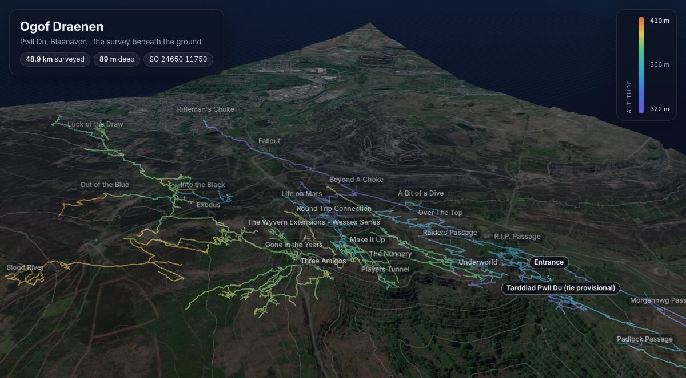
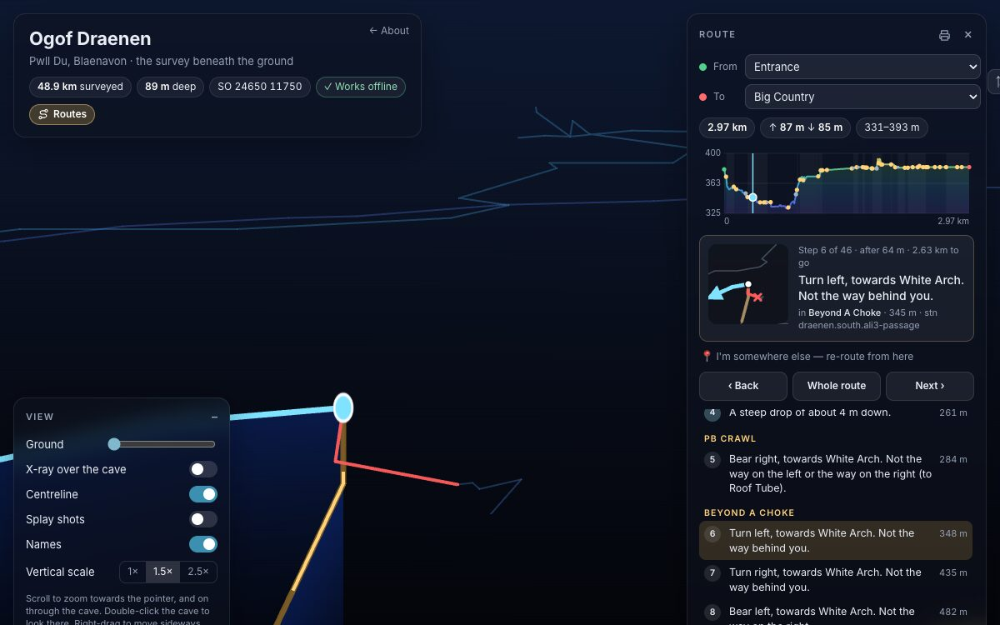
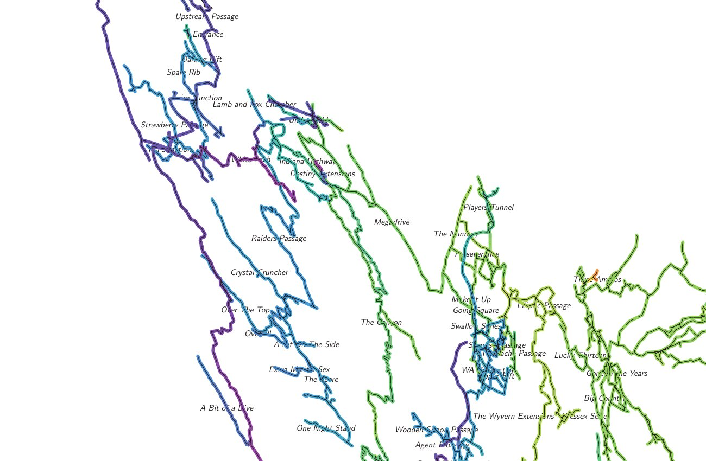

# Ogof Draenen

[](https://paperclipmonkey.github.io/draenen/)

## **[Open the 3D view and route planner →](https://paperclipmonkey.github.io/draenen/)**

The survey of **Ogof Draenen**, under the hill at Pwll Du near Blaenavon,
South Wales, in [Therion](https://therion.speleo.sk/): Oxford University
Cave Club's Grade 2 survey data, converted to Therion, with newer surveys
and their drawings. Every push builds it; `main` publishes:

| | |
|---|---|
| **[The site](https://paperclipmonkey.github.io/draenen/)** | The cave in 3D beneath the Welsh Government's LiDAR ground and satellite imagery, with a route planner: turn-by-turn routes between any two places, offline on a phone underground, and in AR. |
| **[The plan](https://paperclipmonkey.github.io/draenen/data/draenen-plan.pdf)** (`draenen-plan.pdf`) | The plan at 1:5000, coloured by altitude, with the passage names, the entrances, the length and depth, and the credits. |
| **[The survey](https://paperclipmonkey.github.io/draenen/data/draenen.3d)** (`draenen.3d`) | The whole cave as a Survex 3D file, for Aven. |

All three are on the site, which links them together: the landing page
has the downloads beside the 3D view, and the 3D view links them too.
The plan and the `.3d` are also in the [latest release](https://github.com/richsmith/draenen/releases/tag/latest).

| | |
|---|---|
| **49 km** surveyed | **89 m** deep, from 410 m to 322 m above sea level |
| **Entrance** SO 24650 11750, 380 m | **Tarddiad Pwll Du**, a second entrance (its tie into the cave is provisional) |

## The route planner

[](https://paperclipmonkey.github.io/draenen/3d/#from=Entrance&to=Big%20Country&step=6)

**Routes**, under the title, finds the shortest way through the survey
between any two named places, with [ready-made routes from both
entrances](https://paperclipmonkey.github.io/draenen/) on the landing page
(from Tarddiad Pwll Du to the places in the north it's the shorter way to):

- **The whole route** first: its length, climbs and drops, a height
  profile, and a curtain hung from it in 3D.
- **Turn by turn:** each junction from behind and above, the way on in
  blue and the ways not to take in red, with a plan of the junction on
  the step card, which way to turn, up or down, and where the ways not
  taken lead.
- **I'm somewhere else:** tap the passage you're in and it routes again
  from there.
- **Print** the route as a card; **share** it, as the address keeps the
  route and the step ([Entrance to Big Country](https://paperclipmonkey.github.io/draenen/3d/#from=Entrance&to=Big%20Country)).
- **Underground:** open it once with a signal and it works offline. It
  only draws when something changes, to save battery, and the compass can
  turn the survey as you turn.
- **In AR:** the route floating above a base on the floor or a table,
  drawn as on screen (gold dashes running along it, the curtain and posts
  beneath it, the step you're on and the ways not to take, and the
  passages' names), turned to north. On an iPhone or iPad it opens in AR
  Quick Look; on Android (Chrome) it's WebXR, tapping to set it down. On a
  headset (WebXR, in passthrough or VR) it stands on the floor in front of
  you: a grip picks it up and carries it, both grips pull it bigger or
  smaller, the left thumbstick slides it across the floor, the right one
  turns and sizes it, and the trigger puts it where you point.

> The directions come from the survey's centreline, mostly a coarse Grade 2
> survey with long legs: a guide to the shape of the way, not a
> description of the passage. Never depend on a phone underground.

## The plan

[](https://paperclipmonkey.github.io/draenen/data/draenen-plan.pdf)

The plan is coloured by altitude, with a key in the header, so passages
crossing each other stand apart (the higher on top). Therion colours
scraps, not survey lines, and most of the cave is centreline with no
drawing, so `survey/plan.th` has the centreline in short pieces, each a
scrap with the piece as a line `u:ribbon`, which the layout
(`draenen.thconfig`) draws as a band 1.4 mm wide with round ends in the
scrap's colour. The same file names each passage at the station nearest
its middle (leaving out any name that would cover another) and marks the
entrances. Surveys with drawings of their own are coloured by their
drawings.

## Building

```bash
python3 -m tools.plan --empty && (cd survey && therion draenen.thconfig)
python3 -m tools.plan && (cd survey && therion draenen.thconfig)
python3 -m tools.site                    # the site, in site/
python3 -m http.server -d site           # then open http://localhost:8000
```

Therion builds twice: `survey/plan.th` is made from the built survey (and
Therion's database of it, `draenen-stations.sql`). It's committed, so a
plain `therion draenen.thconfig` works too; make it again when the names
or the surveys change. The tools need only Python 3; set `CHROMIUM` to a
Chrome binary for the site's preview image.

CI ([`.github/workflows/build.yml`](.github/workflows/build.yml)) runs
Therion 6.4.0 from a container, `ghcr.io/paperclipmonkey/therion:6.4.0`, as
the [Swildons Hole survey](https://github.com/CaveSurveying/uk_mendips_swildons-hole)
does (Ubuntu's package, 6.2.0, crashes on the plan). The site goes to
GitHub Pages from `main` (Settings → Pages → Source: GitHub Actions).

## Names and entrances

[`survey/names.json`](survey/names.json) names the passages (by Grade 2
survey file), the junctions and the entrances, for the plan, the 3D view
and the routes. The entrances are flagged in the survey
(`station … entrance`).

Both entrances are on the routes. Tarddiad Pwll Du's tie into the cave
is provisional (see [`survey/north/north.th`](survey/north/north.th)): it's
tied in at the base of the Waterfall Series' first climb until the real
tie is known, so for now routes from it start there.

## On the grid

The entrance is fixed where OUCC fixed the same station (SO 24650 11750,
380 m), so heights are above sea level and the survey lines up with the
LiDAR and imagery. It's fixed without a coordinate system (`cs`): with
one, Therion would also turn the survey for magnetic declination, and the
Grade 2 data's `calibrate compass` corrections already take it to grid
north.

## Tools

| | |
|---|---|
| [`tools/names.py`](tools/names.py) | The names and the survey's place on the grid, for the other tools. |
| [`tools/plan.py`](tools/plan.py) | Writes `survey/plan.th`: the plan's coloured ribbon, names and entrances. |
| [`tools/model3d/`](tools/model3d/) | The 3D view and route planner; [`lidar/`](lidar/) keeps the LiDAR it's built on. |
| [`tools/site/`](tools/site/) | The site: a landing page, the 3D view and the outputs. |

## Credits

- **Survey:** Ogof Draenen survey data, [Oxford University Cave Club](https://www.oucc.org.uk/surveys/surveys%20and%20data%20-%20draenen/survex/draenen_survex_data.htm)
  and the many clubs and cavers who surveyed the cave (named in the survey
  files); newer surveys by the teams named in them; compiled in Therion by
  Rich Smith.
- **Ground:** Welsh Government LiDAR 2020–22, © Welsh Government,
  [Open Government Licence v3](https://www.nationalarchives.gov.uk/doc/open-government-licence/version/3/).
- **Imagery:** © Esri, Maxar, Earthstar Geographics and the GIS User Community.
- **Software:** the tools are GPL-3.0 ([`tools/LICENSE`](tools/LICENSE)); the 3D
  view started as the one made for the [Swildons Hole survey](https://github.com/CaveSurveying/uk_mendips_swildons-hole),
  with [three.js](https://threejs.org/) (MIT) and the [Inter](https://rsms.me/inter/)
  font (SIL Open Font Licence).
